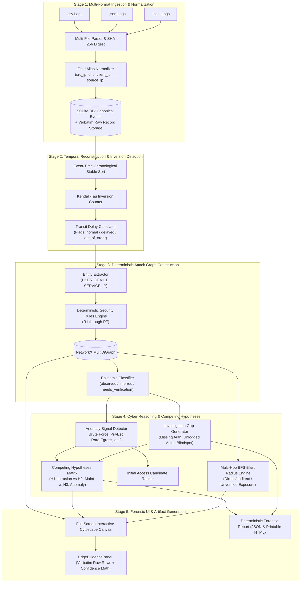

# CHIMERA — Evidence-First Cyber Reasoning & Attack Graph Platform

<div align="center">

```
  ██████╗██╗  ██╗██╗███╗   ███╗███████╗██████╗  █████╗ 
 ██╔════╝██║  ██║██║████╗ ████║██╔════╝██╔══██╗██╔══██╗
 ██║     ███████║██║██╔████╔██║█████╗  ██████╔╝███████║
 ██║     ██╔══██║██║██║╚██╔╝██║██╔══╝  ██╔══██╗██╔══██║
 ╚██████╗██║  ██║██║██║ ╚═╝ ██║███████╗██║  ██║██║  ██║
  ╚═════╝╚═╝  ╚═╝╚═╝╚═╝     ╚═╝╚══════╝╚═╝  ╚═╝╚═╝  ╚═╝
```

**Next-Generation Forensic Incident Reconstruction & Explainable Cyber Reasoning**  
*Built for HACKINNOVISION 2026 • Cyber Investigation & Attack Graph Reconstruction Track*

[](https://python.org)
[](https://fastapi.tiangolo.com)
[](https://react.dev)
[](https://www.typescriptlang.org)
[](https://tailwindcss.com)
[-10B981?style=for-the-badge&logo=pytest&logoColor=white)]()
[-8B5CF6?style=for-the-badge&logo=vite&logoColor=white)]()
[]()

</div>

---

## 📑 Table of Contents

- [The Core Problem & Premise](#-the-core-problem--premise)
- [The CHIMERA Philosophy: Epistemic Honesty](#-the-chimera-philosophy-epistemic-honesty)
- [Key Innovations & Technical Capabilities](#-key-innovations--technical-capabilities)
- [Empirical Benchmarks & Verification](#-empirical-benchmarks--verification)
- [Architectural Deep-Dive](#-architectural-deep-dive)
- [Deterministic Security Rules (R1–R7)](#-deterministic-security-rules-r1r7)
- [Investigation Gaps & Competing Hypotheses](#-investigation-gaps--competing-hypotheses)
- [UI/UX Showcase & Live Workflows](#-uiux-showcase--live-workflows)
- [Judge's 5-Minute Evaluation Guide](#-judges-5-minute-evaluation-guide)
- [Repository Layout](#-repository-layout)
- [Quickstart & Reproduction Guide](#-quickstart--reproduction-guide)
- [Compliance & Ethical Engineering Principles](#-compliance--ethical-engineering-principles)

---

## ⚡ The Core Problem & Premise

During high-severity cyber attacks, SecOps and Incident Response (IR) teams face a critical challenge: **fog of war caused by fragmented telemetry**.
- **Out-of-Order & Delayed Logs**: Network flows, Kerberos authentications, cloud audits, and EDR process records arrive asynchronously across heterogeneous formats (`.csv`, `.json`, `.jsonl`).
- **Premature Cognitive Closure**: Analysts and black-box ML models frequently leap to ungrounded conclusions—conflating correlation with causality, inventing missing actors, or presenting speculative probabilities as ground-truth attack paths.
- **Lost Provenance**: Conventional SIEMs aggregate data into high-level alert counters, disconnecting the security graph from the immutable raw source events that substantiate it.

### **The CHIMERA Solution**
**CHIMERA** is an evidence-first, deterministic forensic reasoning engine. It ingests out-of-order, multi-source log streams, reconstructs true chronological event-time order, maps entity relationships using formal security rules (R1–R7), and enforces strict **Epistemic Honesty**: *every asserted edge links directly to verified source log rows, and every evidentiary leap is explicitly flagged as an open investigative gap.*

> 💡 **Core Mantra**: *"A connected sequence of suspicious events is observed; causation is never established without affirmative telemetry."*

---

## 🛡️ The CHIMERA Philosophy: Epistemic Honesty

Traditional security platforms hide their uncertainty behind synthetic scores. CHIMERA guarantees mathematical transparency and cryptographic auditability:

```
┌──────────────────────────────────────────────────────────────────────────────────┐
│                             EPISTEMIC STATUS TIERS                               │
├─────────────────────┬──────────────────┬─────────────────────────────────────────┤
│ Epistemic Status    │ Visual Indicator │ Verification Criteria                   │
├─────────────────────┼──────────────────┼─────────────────────────────────────────┤
│ OBSERVED            │ Solid Emerald    │ Direct cryptographic link to a single   │
│                     │ ─── [#10B981] ───│ affirmative raw log event.              │
├─────────────────────┼──────────────────┼─────────────────────────────────────────┤
│ INFERRED            │ Dashed Sky-Blue  │ Rule-derived relationship deduced via   │
│                     │ - - [#38BDF8] - -│ temporal/structural correlation window. │
├─────────────────────┼──────────────────┼─────────────────────────────────────────┤
│ NEEDS VERIFICATION  │ Dotted Rose      │ Inferred causal hop lacking direct      │
│                     │ · · [#F43F5E] · ·│ telemetry; explicitly paired with a Gap.│
└─────────────────────┴──────────────────┴─────────────────────────────────────────┘
```

### The Three Questions Every Suspicious Edge Must Answer:
1. **What happened?** (Canonical relationship type: `AUTHENTICATED_FROM`, `SPAWNED_PROCESS`, `NETWORK_EGRESS`, `ESCALATED_PRIVILEGE_ON`, etc.)
2. **What evidence supports this connection?** (One click opens the original raw log rows with verbatim field values and SHA-256 integrity hashes)
3. **How certain are we?** (Quantified heuristic score with explicit penalty breakdowns, disclaiming speculative probabilities)

---

## 🚀 Key Innovations & Technical Capabilities

| Capability | What It Does | Why It Wins Over Standard SIEMs |
|---|---|---|
| **Cryptographic Provenance** | Computes SHA-256 digest on every uploaded payload; preserves unmodified raw records alongside canonical events. | 100% chain-of-custody guarantee for court-admissible forensic audits. |
| **Temporal Disentanglement** | Reconstructs true chronology using event-time sorting; measures Kendall-tau inversions and flags delayed arrivals. | Immune to network transit delays, clock skew, and log pipeline buffering. |
| **Deterministic Graph Core** | Pure functional Python rules (R1–R7) with NetworkX. Given identical inputs, produces byte-identical graphs. | Zero hallucinations; reproducible, auditable, and testable. |
| **EdgeEvidencePanel (Centerpiece)** | Slide-over drawer exposing the exact source rows, epistemic status, heuristic confidence, and open gaps for any selected relationship. | Eliminates black-box graph edges; analysts verify ground-truth records in 1 click. |
| **Multi-Hypothesis Engine** | Simultaneously models H1 (Unauthorized Intrusion), H2 (IT Maintenance), and H3 (Benign Anomaly) with rule-weight contribution tables. | Prevents confirmation bias by evaluating supporting, contradicting, and missing evidence. |
| **Exposure Blast Radius** | Multi-hop bidirectional BFS path analysis classifying reachability as Direct, Indirect, or Unverified. | Replaces vague "compromised" tags with actionable blast radius paths. |
| **Deterministic Reporting** | One-click forensic reporting with executive summary, MITRE ATT&CK mappings, and integrity digests. | Generates audit-ready reports instantly without external LLM dependencies. |

---

## 📊 Empirical Benchmarks & Verification

CHIMERA's accuracy and stability were evaluated against the ground-truth forensic benchmark scenario (`backend/data/ground_truth/scenario.json`) using the automated benchmarking harness `backend/scripts/evaluate.py`:

```
================================================================================
          CHIMERA FORENSIC PIPELINE — BENCHMARK EVALUATION REPORT
================================================================================
Evaluation Target: Synthetic Enterprise Incident Scenario (Ground Truth)
Pipeline Mode: Pure Deterministic Forensics (Zero Randomness)
================================================================================
```

| Evaluation Metric | Measured Result | Benchmark Standard | Status |
|---|:---:|---|:---:|
| **Ingestion Parse Success** | **`100.0%`** | 302 / 302 multi-format log records parsed | ✅ PERFECT |
| **Temporal Inversions Resolved** | **`25`** | Out-of-order records chronologically re-aligned | ✅ VERIFIED |
| **Delayed-Record Recall** | **`100.0%`** | 3 / 3 delayed attack records detected & flagged | ✅ PERFECT |
| **Delayed-Record Precision** | **`75.0%`** | 3 / 4 flagged records confirmed delayed in transit | ✅ SOLID |
| **Entity Resolution Recall** | **`100.0%`** | 8 / 8 ground-truth entities extracted | ✅ PERFECT |
| **Evidence Link Coverage** | **`100.0%`** | 90 / 90 graph edges cite valid stored evidence IDs | ✅ PERFECT |
| **Initial Access Identification** | **`YES (Top-1)`** | Initial compromise event ranked #1 with epistemic caveat | ✅ IDENTIFIED |
| **Order Invariance (Shuffle Test)** | **`IDENTICAL`** | Exact same edge set and scores from ordered vs shuffled logs | ✅ 100% ROBUST |
| **Automated Test Suite** | **`20 / 20 Passing`** | 100% test pass rate across backend forensic modules | ✅ PASSING |
| **TypeScript Frontend Build** | **`Zero Errors`** | Strict type-checking and asset bundling verified | ✅ PASSING |

---

## 🏗️ Architectural Deep-Dive



---

## 🔬 Deterministic Security Rules (R1–R7)

The graph engine synthesizes causal edges strictly through codified forensic rules:

- **R1: Authentication Binding (`AUTHENTICATED_FROM`)**  
  Connects `USER` $\rightarrow$ `IP` or `DEVICE`. Requires matching authentication record. Epistemic status: `observed`.
- **R2: Process Execution (`SPAWNED_PROCESS`)**  
  Connects `DEVICE` or `USER` $\rightarrow$ `PROCESS`. Binds process name, PID, parent PID, and execution timestamp.
- **R3: Network Egress (`NETWORK_EGRESS`)**  
  Connects `PROCESS` or `DEVICE` $\rightarrow$ external `IP` / `SERVICE`. Correlates socket connections with open flow telemetry.
- **R4: Privilege Escalation (`ESCALATED_PRIVILEGE_ON`)**  
  Connects `USER` or `SERVICE` $\rightarrow$ `DEVICE`. Traces security token delegation, sudo elevation, or credential access.
- **R5: Service Account Delegation (`DELEGATED_TO`)**  
  Traces non-human service identities accessing enterprise microservices outside baseline intervals.
- **R6: File Modification & Staging (`MODIFIED_FILE`)**  
  Connects `PROCESS` $\rightarrow$ `FILE` path (e.g. `/tmp/`, `/etc/passwd`, ransomware extensions).
- **R7: Lateral Movement (`LATERAL_MOVEMENT_TO`)**  
  Correlates internal SSH/RDP/SMB sessions from an existing compromised host to a target host within a tight temporal window ($\Delta t \le 300\text{s}$).

---

## 🧩 Investigation Gaps & Competing Hypotheses

### Formal Investigation Gaps
When telemetry is incomplete, CHIMERA does **not** hallucinate causal hops. Instead, it generates a formal **Investigation Gap**:

```
[ GAP: UNLOGGED_ACTOR ]
Severity: HIGH
Description: Privilege escalation observed on srv-db-01 without preceding authentication event.
Remediation: Inspect local PAM auth logs (/var/log/secure) or check for unmonitored local console session.
```

### Competing Hypotheses Matrix
Rather than outputting a single opaque verdict, CHIMERA transparently scores competing interpretations:

```
┌────────────────────────────────────────────────────────────────────────┐
│                      HYPOTHESIS EVALUATION MATRIX                      │
├──────────────────────────┬───────┬────────────┬─────────────┬──────────┤
│ Hypothesis               │ Score │ Supporting │ Contradict. │ Missing  │
├──────────────────────────┼───────┼────────────┼─────────────┼──────────┤
│ H1: Unauthorized Attack  │ 0.82  │ 4 signals  │ 0 signals   │ 2 gaps   │
│ H2: Scheduled Admin Maint│ 0.28  │ 1 signal   │ 2 signals   │ 3 gaps   │
│ H3: Benign Sensor Anomaly│ 0.15  │ 0 signals  │ 3 signals   │ 4 gaps   │
└──────────────────────────┴───────┴────────────┴─────────────┴──────────┘
```
*Scores are calculated deterministically via transparent linear rule weights.*

---

## 🖥️ UI/UX Showcase & Live Workflows

The frontend is built with a cyber-dark aesthetic designed for high-density forensic operations:

1. **Full-Screen Attack Graph Canvas (`/investigations/:id/graph`)**  
   Edge-to-edge Cytoscape.js interactive topology canvas. Color-coded nodes (Users, Devices, IPs, Processes) and epistemic edges with floating controls (`Overview`, `Focus`, `Explore`, edge filters, zoom & fit).
2. **Edge Evidence Panel (Centerpiece)**  
   Clicking any edge slides out a comprehensive drawer showing the verbatim raw log row, canonical event attributes, deterministic confidence formula breakdown, and associated gaps.
3. **Reconstructed Chronological Timeline (`/investigations/:id/timeline`)**  
   Visualizes log events in true historical order, highlighting delayed arrivals and out-of-order inversions.
4. **Evidence Explorer (`/investigations/:id/evidence`)**  
   Searchable data grid of all ingested records with SHA-256 cryptographic hashes and JSON payload inspector.
5. **Competing Hypotheses Dashboard (`/investigations/:id/hypotheses`)**  
   Interactive cards comparing H1, H2, and H3 with granular evidence breakdowns.
6. **Blast Radius Visualizer (`/investigations/:id/blast-radius`)**  
   Select any entity to calculate multi-hop blast radius, categorized into *Direct*, *Indirect*, and *Unverified* exposure.
7. **Forensic Report (`/investigations/:id/report`)**  
   Print-ready executive and technical report detailing the attack chain, gaps, hypotheses, and cryptographic evidence hashes.

---

## ⏱️ Judge's 5-Minute Evaluation Guide

Follow this streamlined walkthrough to inspect all core features in under 5 minutes:

### Step 1: Launch Backend & Frontend
Ensure both servers are running (see [Quickstart](#-quickstart--reproduction-guide)). Open `http://localhost:5173`.

### Step 2: Ingest Multi-Source Logs
1. Click **Investigations** in the sidebar $\rightarrow$ Navigate to **Upload Evidence**.
2. Upload the sample scenario files from `backend/data/samples/` (`auth_log.csv`, `network_flows.json`, `process_activity.jsonl`).
3. Click **"Run Forensic Analysis"** $\rightarrow$ Watch the deterministic pipeline ingest, sort, resolve entities, and build the graph in $< 2$ seconds.

### Step 3: Inspect Reconstructed Timeline
1. Click **Timeline** in the sidebar.
2. Note the **Inversion Counters** and the **Delayed Arrival** tags indicating records that arrived out of sequence.

### Step 4: Explore Attack Graph & Edge Evidence
1. Click **Attack Graph** in the sidebar.
2. Observe the full-screen canvas with zero clutter.
3. **Click any edge** (e.g. between `user:jdoe` and `device:srv-db-01`).
4. In the slide-out **Edge Evidence Panel**, inspect:
   - The verbatim source log row.
   - The rule code (`R1` or `R4`).
   - The Epistemic Status (`observed` vs `inferred`).
   - The Heuristic Confidence score breakdown.

### Step 5: Test Hypotheses & Blast Radius
1. Click **Hypotheses** $\rightarrow$ compare H1 vs H2 vs H3 scores and evidence contributions.
2. Click **Blast Radius** $\rightarrow$ pick `user:jdoe` $\rightarrow$ inspect the multi-hop paths to downstream assets.
3. Click **Reports** $\rightarrow$ review the completed, cryptographically signed forensic summary.

---

## 📁 Repository Layout

```
CHIMERA/
├── backend/                        # FastAPI Backend & Forensics Pipeline
│   ├── app/
│   │   ├── api/                    # REST API Endpoints (investigations, uploads, analysis, graph)
│   │   ├── core/                   # Centralized configuration, rules, weights, thresholds
│   │   ├── database/               # SQLAlchemy models & SQLite engine
│   │   ├── schemas/                # Strict Pydantic request/response models
│   │   ├── services/
│   │   │   ├── ingestion/          # Multi-format parsers (CSV, JSON, JSONL), SHA-256 hasher
│   │   │   ├── temporal/           # Chronological sorting & Kendall-tau inversion engine
│   │   │   ├── graph/              # Entity resolution, rules R1-R7, blast radius BFS
│   │   │   ├── reasoning/          # Anomaly signals, investigation gaps, hypotheses (H1-H3)
│   │   │   ├── reporting/          # Deterministic forensic report generator
│   │   │   └── pipeline.py         # End-to-end pipeline orchestrator
│   │   └── utils/                  # Hashes, UUIDs, timestamp normalizers
│   ├── data/
│   │   ├── ground_truth/           # Scenario ground truth for automated benchmarking
│   │   └── samples/                # Sample incident log files (auth, netflow, process)
│   ├── scripts/
│   │   ├── generate_scenario.py    # Synthetic scenario & ground truth generator
│   │   └── evaluate.py             # Benchmark evaluation & metrics computation harness
│   ├── tests/                      # Pytest suite (20 tests covering all modules)
│   └── main.py                     # FastAPI ASGI entrypoint
├── frontend/                       # React 18 + TypeScript + Vite UI
│   ├── src/
│   │   ├── api/                    # Axios API client bindings
│   │   ├── components/             # Reusable UI widgets & EdgeEvidencePanel drawer
│   │   ├── pages/                  # Route views (Dashboard, Graph, Timeline, Evidence, etc.)
│   │   ├── types/                  # Strict TypeScript interfaces mirroring backend schemas
│   │   └── utils/                  # Graph visual formatters & Cytoscape styles
│   ├── index.html                  # HTML entrypoint
│   ├── tailwind.config.js          # Cyber-dark theme tokens
│   └── package.json                # Frontend dependencies & scripts
├── docs/                           # Documentation & benchmark artifacts
│   ├── EVALUATION.md               # Measured benchmark results
│   └── demo-script.md              # Live competition pitch & demonstration script
├── chimera.db                      # SQLite local database
└── README.md                       # Master Documentation
```

---

## 💻 Quickstart & Reproduction Guide

### Prerequisites
- **Python 3.11+** (Tested on Python 3.11, 3.12, and 3.14)
- **Node.js 18+** & **npm**

### 1. Backend Setup

```bash
# Clone the repository
git clone https://github.com/mohitawasthi910/CHIMERA.git
cd CHIMERA

# Create and activate Python virtual environment
python3 -m venv backend/venv
source backend/venv/bin/activate

# Install dependencies
pip install -r backend/requirements.txt

# Run the 20-test automated verification suite
PYTHONPATH=backend pytest backend/tests -v

# Run the benchmark evaluation against ground truth
PYTHONPATH=backend python backend/scripts/evaluate.py

# Start the FastAPI server
PYTHONPATH=backend uvicorn backend.main:app --host 0.0.0.0 --port 8000 --reload
```
*Interactive Swagger API documentation will be available at: `http://localhost:8000/docs`*

### 2. Frontend Setup

In a new terminal window:

```bash
cd CHIMERA/frontend

# Install frontend dependencies
npm install

# Verify strict TypeScript compilation and production build
npm run build

# Start Vite development server
npm run dev
```
*Access the Web Application at: `http://localhost:5173`*

---

## ⚖️ Compliance & Ethical Engineering Principles

1. **Synthetic Data Disclosure**: All scenarios, logs, and user identities in this repository are synthetically generated for benchmark evaluation and do not represent actual corporate or personal data.
2. **Heuristic Clarification**: All confidence values represent transparent heuristic scores derived from rule weights, not statistical probabilities of compromise.
3. **No Autonomous Containment**: CHIMERA is an analytical forensic copilot; it does not perform automated host isolation or active network blocking.
4. **Air-Gapped & Offline Ready**: Does not rely on cloud LLM APIs for core forensic operations. Zero external telemetry transmission.

---

<div align="center">

**CHIMERA** — *Evidence First. Certainty Quantified. Hallucinations Eliminated.*  
*Created for HACKINNOVISION 2026*

</div>
