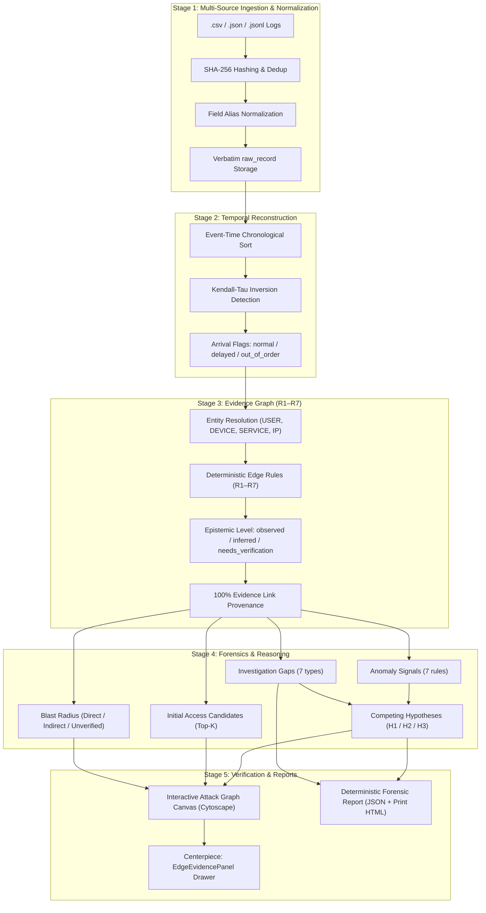

# CHIMERA — Evidence-First Cyber Reasoning & Attack Graph Platform

[](https://python.org)
[](https://fastapi.tiangolo.com)
[](https://react.dev)
[](https://www.typescriptlang.org)
[](https://tailwindcss.com)
[]()
[]()

> **HACKINNOVISION 2026** • Cyber Investigation & Attack Graph Reconstruction Track  
> *Built with strict Epistemic Honesty: Zero ungrounded assertions, 100% cryptographic provenance, and deterministic multi-hypothesis reasoning.*

---

## Executive Summary

When complex cyber incidents strike enterprise networks, raw security telemetry arrives fragmented, out-of-order, delayed, and dispersed across heterogeneous formats (`.csv`, `.json`, `.jsonl`). Conventional security tools frequently suffer from **premature cognitive closure**—asserting ungrounded causal leaps or mistaking heuristic anomaly scores for attack probabilities.

**CHIMERA** is an evidence-first, deterministic forensic investigation platform. It:
1. **Preserves Provenance**: Retains verbatim raw log records alongside cryptographic SHA-256 hashes of all source evidence.
2. **Reconstructs True Chronology**: Resolves out-of-order and delayed arrivals via strict timestamp normalization and Kendall-tau inversion counting.
3. **Builds an Evidence-Backed Attack Graph**: Extracts entities and constructs causal edges using deterministic security rules (R1–R7) with explicit epistemic statuses (`observed`, `inferred`, `needs_verification`).
4. **Enforces Epistemic Honesty**: Refuses to hallucinate missing links; instead, it flags formal **Investigation Gaps** and requires grounding evidence IDs for every single edge.
5. **Evaluates Competing Hypotheses**: Simulates Alternative Explanations (H1: Intrusion, H2: Maintenance, H3: Benign Anomaly) using transparent linear contribution tables.
6. **Classifies Blast Radius**: Applies a multi-hop BFS strongest-weakest path algorithm to distinguish directly associated assets from indirect or unverified exposures.

---

## Empirical Evaluation Results

All metrics below were measured against the ground-truth evaluation benchmark (`backend/data/ground_truth/scenario.json`) using `backend/scripts/evaluate.py`:

| Evaluation Metric | Measured Value | Benchmark Description |
|---|---|---|
| **Ingestion Success** | **`100.0%`** | 302/302 multi-format log records successfully parsed |
| **Temporal Inversions Resolved** | **`25`** | Out-of-order records correctly chronologized |
| **Delayed-Record Recall** | **`100.0%`** | 3/3 delayed incident log events detected and flagged |
| **Delayed-Record Precision** | **`75.0%`** | 3/4 flagged records correctly identified as delayed |
| **Entity Recall** | **`100.0%`** | 8/8 ground-truth entities extracted and resolved |
| **Evidence Coverage** | **`100.0%`** | 90/90 graph edges cite valid, existing evidence IDs |
| **Initial Access Hit** | **`YES (Top-1)`** | Initial compromise event ranked #1 with caveat |
| **Shuffle Robustness** | **`IDENTICAL`** | Exact same edge set and scores from ordered vs shuffled logs |

---

## Architectural Workflow



---

## Epistemic Status Tiers

Every node, relationship, and finding in CHIMERA is governed by explicit epistemic guardrails:

| Epistemic Status | Visual Representation | Definition & Criteria |
|---|---|---|
| **Observed** | Solid Green (`#10b981`) | Directly grounded in a single, verified log row (e.g., successful Kerberos authentication). |
| **Inferred** | Dashed Amber (`#f59e0b`) | Logically deduced via temporal proximity and correlation windows across two related events. |
| **Needs Verification** | Dotted Rose (`#f43f5e`) | High-consequence causal hop lacking affirmative telemetry (e.g., privilege escalation without logged actor). |

---

## Repository Structure

```
CHIMERA/
├── backend/                        # FastAPI Backend & Forensics Pipeline
│   ├── app/
│   │   ├── api/                    # REST API Endpoints
│   │   │   ├── investigations.py   # Investigation lifecycle & dashboard
│   │   │   ├── uploads.py          # Multi-file upload & raw event queries
│   │   │   ├── analysis.py         # Pipeline execution, timeline, hypotheses
│   │   │   └── graph.py            # Graph topology & edge evidence inspection
│   │   ├── core/                   # Configuration & centralized rules/weights
│   │   ├── database/               # SQLAlchemy models & SQLite engine
│   │   ├── schemas/                # Pydantic request/response schemas
│   │   ├── services/
│   │   │   ├── ingestion/          # CSV/JSON/JSONL parsers & normalizers
│   │   │   ├── temporal/           # Chronological ordering & delay calculation
│   │   │   ├── graph/              # Entity extraction, R1-R7 builder, blast radius
│   │   │   ├── reasoning/          # Signals, gaps, hypotheses, initial access
│   │   │   ├── reporting/          # Deterministic report synthesizer
│   │   │   └── pipeline.py         # End-to-end orchestration pipeline
│   │   └── utils/                  # Hashes, IDs, timestamp helpers
│   ├── data/                       # Synthetic scenarios & ground truth
│   ├── scripts/
│   │   ├── generate_scenario.py    # Deterministic incident generator
│   │   └── evaluate.py             # Evaluation & benchmarking suite
│   ├── tests/                      # Pytest Suite (20 tests, 100% passing)
│   └── main.py                     # ASGI Entrypoint
├── frontend/                       # React 18 + TypeScript + Vite UI
│   ├── src/
│   │   ├── api/                    # Axios API client
│   │   ├── components/             # Reusable UI components & EdgeEvidencePanel
│   │   ├── pages/                  # Route views (Dashboard, Graph, Timeline, etc.)
│   │   └── types/                  # Strict TypeScript domain interfaces
│   ├── index.html
│   ├── tailwind.config.js          # Cyber-dark theme palette
│   └── package.json
├── docs/                           # Documentation & Evaluation Artifacts
│   ├── EVALUATION.md               # Measured benchmark results
│   └── demo-script.md              # 5-minute competition demo script
└── README.md                       # This document
```

---

## Quickstart & Local Setup

### Prerequisites
- Python 3.11+ (Python 3.14 compatible)
- Node.js 18+ & npm

### 1. Backend Setup & Run

```bash
# Clone the repository
cd CHIMERA

# Set up Python virtual environment
python3 -m venv backend/venv
source backend/venv/bin/activate

# Install dependencies
pip install -r backend/requirements.txt

# Run the 20-test verification suite
PYTHONPATH=backend pytest backend/tests -v

# Start the FastAPI backend server
PYTHONPATH=backend uvicorn backend.main:app --host 0.0.0.0 --port 8000 --reload
```

*API Documentation will be accessible at: `http://localhost:8000/docs`*

### 2. Frontend Setup & Run

```bash
cd frontend

# Install npm dependencies
npm install

# Build for production (verifies strict TypeScript compilation)
npm run build

# Start the Vite development server
npm run dev
```

*Frontend UI will be accessible at: `http://localhost:5173`*

---

## Running the Evaluation Benchmark

To verify pipeline reproducibility and reproduce the empirical metrics:

```bash
PYTHONPATH=backend backend/venv/bin/python backend/scripts/evaluate.py
```

This will run the entire pipeline against `backend/data/ground_truth/scenario.json` and output the results directly into `docs/EVALUATION.md`.

---

## Key Features & UI Tour

1. **Dashboard (`/`)**: High-level overview of open cases, total evidence items, resolved temporal inversions, and detected gaps.
2. **Evidence Explorer (`/investigations/:id/evidence`)**: Searchable, paginated audit table with raw record JSON inspector and SHA-256 provenance cards.
3. **Reconstructed Timeline (`/investigations/:id/timeline`)**: Chronological sequence showing delayed arrivals, out-of-order records, and Kendall-tau inversions.
4. **Attack Graph Canvas (`/investigations/:id/graph`)**: Interactive Cytoscape graph styled by entity type and epistemic edge status (`observed`, `inferred`, `needs_verification`).
5. **Edge Evidence Panel (Centerpiece)**: Slide-over drawer displaying verbatim source log rows, rule explanations, deterministic confidence calculations, and open gaps.
6. **Competing Hypotheses (`/investigations/:id/hypotheses`)**: Transparent scoring comparing H1 (Unauthorized Access), H2 (Maintenance), and H3 (Benign Anomaly) with rule contribution tables.
7. **Blast Radius Analysis (`/investigations/:id/blast-radius`)**: Multi-hop exposure classification (Direct vs Indirect vs Unverified) with graph path highlighting.
8. **Forensic Report (`/investigations/:id/report`)**: Clean, printable executive summary with cryptographic hashes and synthetic data badges.

---

## Verification & Compliance

- **20 / 20 Pytest Tests Passing** (E2E, temporal, graph, ingestion, blast radius, hypotheses, provenance, shuffle invariance).
- **TypeScript Strict Mode Verified**: Built cleanly via `npm run build` with zero errors.
- **Epistemic Honesty Enforced**: Every asserted relationship contains $\ge 1$ evidence ID; no fabricated actors; all heuristic scores disclaimed.

---

*Developed for HACKINNOVISION 2026 • CHIMERA Team*
